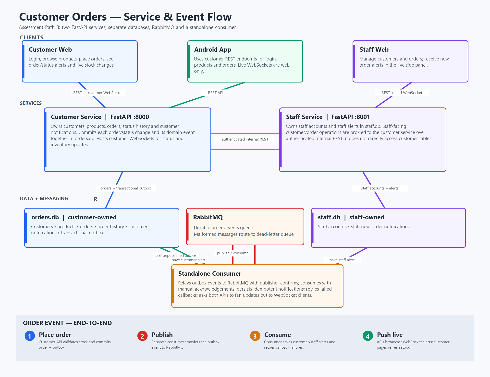

# Customer Orders: Web, Android, and RabbitMQ

This project extends the original Customer Orders API with distinct customer and staff backend services, a RabbitMQ event workflow, and live web updates over WebSockets. The Android client continues to use just the customer REST API. The selected advanced integration is **Path B: message broker**.

## Architecture

Customer web client / Android
          | HTTP + WebSocket
          v
Customer service :8000 <----- internal REST ----- Staff service :8001
  | owns orders.db                                  | owns staff.db
  | customers, products, orders, outbox              | staff accounts, staff alerts
  |                                                  |
  +---------------- order/status outbox -------------+
                         |
                         v
                  RabbitMQ: orders.events
                         |
                         v
               Separate consumer process
                 |                      |
                 v                      v
        customer service WS      staff service WS
        status + inventory       new-order alerts

The customer service owns customer/order data and its outbox in `orders.db`; the staff service owns staff data and alerts in `staff.db`. Staff accesses customer/order data through authenticated internal REST calls, not direct database queries. Each order or status change and its outbox event are saved in one transaction. A separate consumer publishes events to RabbitMQ; manual acknowledgements, event-ID idempotency, retries, and a dead-letter queue support reliable delivery.

New orders create saved customer and staff alerts, refresh inventory on open customer pages, and notify open staff pages. Status changes notify the affected customer's browser. Both web clients reconnect and restore saved alerts; Android uses the customer REST API. Alert times are stored in UTC and displayed in `Pacific/Auckland`; delayed alerts retain the original event time.

## Prerequisites

- Python 3.12 or newer and pip, for local development.
- Docker Desktop with Docker Compose, for the simplest complete launch (RabbitMQ, both APIs, and the consumer).
- Android Studio and a compatible Android SDK to build/run the Android client.

## Run the complete system with Docker Compose

- Have the Docker Engine running

- Create your local configuration file from the supplied example. `.env` holds the
  local development credentials and is not committed to the repository. Docker Compose
  reads it automatically:

copy .env.example .env

  Then edit `.env` and set `RABBITMQ_PASSWORD` to a password of your choice (letters,
  digits and hyphens only). The other values can stay as they are.

- First time -> From the repository root in PowerShell:

docker compose build
docker compose up -d rabbitmq
docker compose run --rm --no-deps customer-service python seed.py
docker compose up -d
docker compose ps

- To start the services without resetting existing data, use this separate sequence instead. It preserves data in the named volumes and does not create the demo accounts or products on a fresh installation:

docker compose build
docker compose up -d rabbitmq
docker compose up -d
docker compose ps

Open the customer login at `http://localhost:8000/` and the staff client at `http://localhost:8001/`. Customer login is shown by default; to resume a browser-stored customer session explicitly, use `http://localhost:8000/?resume=1`. API documentation is available at `/docs` on each service. RabbitMQ's local management page is `http://localhost:15672/` (sign in with `RABBITMQ_USER` / `RABBITMQ_PASSWORD` from your `.env`).

Follow service logs with `docker compose logs -f customer-service staff-service consumer rabbitmq`.

## Close the project

- From the repository root, stop and remove the project containers and network:

docker compose down

- This keeps persistent data so you can start the project again later. To also delete the database volumes and their data:

docker compose down --volumes

- Can use Docker desktop instead to stop the running container

## Demo accounts and shared workflow

After seeding:

- Customer web/Android login: **Evan**, `evan@test.com`.
- Another customer: **Bob**, `bob@test.com`.
- Staff login: `sam@test.com`, password **dummypw**.
- Sample products: Keyboard, Mouse, and Monitor.

To demonstrate the shared workflow:

1. Sign in as Evan at `http://localhost:8000/`, create an order, then open **View Orders** and leave the page open. It connects to `/ws/customers/{customer_id}/orders`.
2. Sign in to staff at `http://localhost:8001/`, open **Update Status**, and advance Evan's order from `pending` to `paid`.
3. When Evan places the order, every open staff page displays a live notification without refresh. Customer pages refresh product stock automatically, and Evan sees a saved order notification.
4. Leave the customer order page open, then advance Evan's order from `pending` to `paid` on the staff page. The customer page displays the live status update without refresh; the consumer saves a customer notification available from `GET /customers/{customer_id}/notifications`.
5. To demonstrate recovery, temporarily stop a service or RabbitMQ container. An event remains in the outbox or is requeued; restore the component and confirm that the pages reconnect, restore saved notifications, and refresh current data.

The status workflow is `pending -> paid -> shipped -> delivered`. Orders require either a typed delivery address or both latitude and longitude; the Android client continues to submit device location with manual-address fallback.

## API and ports

| Service | Port | Main routes |
| --- | ---: | --- |
| Customer service | 8000 | `GET /health`, `POST /customer-login`, `GET /customers`, `POST /customers`, `GET /customers/{id}`, `GET /products`, `POST /customers/{id}/orders`, `GET /customers/{id}/orders`, `GET /customers/{id}/notifications`, `WS /ws/customers/{id}/orders`, `WS /ws/customer-updates` |
| Staff service | 8001 | `GET /health`, `POST /staff-login`, `GET/POST /staff/customers`, `GET /staff/products`, `GET /staff/orders`, `GET /staff/notifications`, `GET /staff/customers/{id}/orders`, `PATCH /staff/orders/{id}`, `WS /ws/staff/orders` |
| RabbitMQ | 5672 | Durable queue `orders.events`; malformed events go to `orders.events.dead` |
| RabbitMQ management | 15672 | Local development UI |

## Verification

- The representative response-time check measures repeated `GET /products` requests against the customer API; its acceptance target is a local 95th-percentile response time below 250 ms:

python scripts/measure_response_time.py

In the implementation validation environment, 30 sequential loopback requests measured a mean of **17.80 ms** and p95 of **27.31 ms**, meeting the target. This is a local development observation, not a production benchmark; rerun on the demonstration machine and record its conditions/results.

- Build the Android app from the repository root:

Set-Location android-client
.\gradlew.bat assembleDebug

For an Android emulator, the app uses `10.0.2.2:8000` to reach the host customer service. For a physical phone, set `ApiClient.BASE_URL` in the Android project to the development computer's LAN address.

## Configuration

Local credentials live in `.env`, which is created from [`.env.example`](.env.example) and is
ignored by git. Compose fails fast with a clear message if `RABBITMQ_PASSWORD` is missing, so a
copy of the example with the password set is all that is needed to run the system.

| Variable | Default | Purpose |
| --- | --- | --- |
| `RABBITMQ_USER` | `orders` | Broker account name, also used as the management UI sign-in. |
| `RABBITMQ_PASSWORD` | *(none — required)* | Broker account password. Required in `.env`; nothing is committed. |
| `RABBITMQ_HOST` | `localhost` | Broker hostname. Compose overrides this with the `rabbitmq` service name. |
| `DATABASE_URL` | `sqlite:///./orders.db` | Customer-owned database; the consumer reads its outbox and writes customer notifications here. |
| `STAFF_DATABASE_URL` | `sqlite:///./staff.db` | Staff-owned database for staff login and notifications. |
| `RABBITMQ_URL` | built from `RABBITMQ_USER` / `RABBITMQ_PASSWORD` / `RABBITMQ_HOST` | RabbitMQ AMQP connection URL. Set it directly only if you need a full URL; otherwise the parts in `.env` are used. |
| `ORDERS_QUEUE` | `orders.events` | Durable order-event queue. |
| `ORDERS_DEAD_LETTER_QUEUE` | `orders.events.dead` | Dead-letter destination for malformed messages. |
| `CUSTOMER_SERVICE_URL` | `http://127.0.0.1:8000` | Customer API base URL used by the consumer callback. |
| `STAFF_SERVICE_URL` | `http://127.0.0.1:8001` | Staff API base URL used by the consumer for new-order notifications. |
| `INTERNAL_EVENT_TOKEN` | `local-development-token` | Shared token for the consumer-to-customer internal callback. Change outside local demos. |
| `WEB_ORIGINS` | Localhost ports 8000 and 8001 | Comma-separated browser origins permitted by each API. |
| `STAFF_PASSWORD` | `dummypw` | Demo staff password checked by the staff login endpoint. |

For a non-Docker local run, set the same variables in your shell instead; `settings.py`
loads `.env` at startup, so a `.env` file works for both ways of running the system.

## Known limitations

- Demo sign-in is not production authentication: customer login checks name/email, staff uses a shared demo password, and WebSocket connections are not authenticated.
- The customer and staff services own separate SQLite files. The consumer accesses both databases to relay events and persist each role's notifications; Docker stores the two files on one named volume.
- RabbitMQ provides at-least-once delivery. Notification persistence is idempotent by event ID; the consumer retries transient failures up to three attempts and republishes pending outbox records. A message that fails three times is dead-lettered to `orders.events.dead`.
- Android is a customer workflow client; the staff workflows are web-only.
- Android has not implemented websockets as only one web client was required in assignment brief to implement the feature
